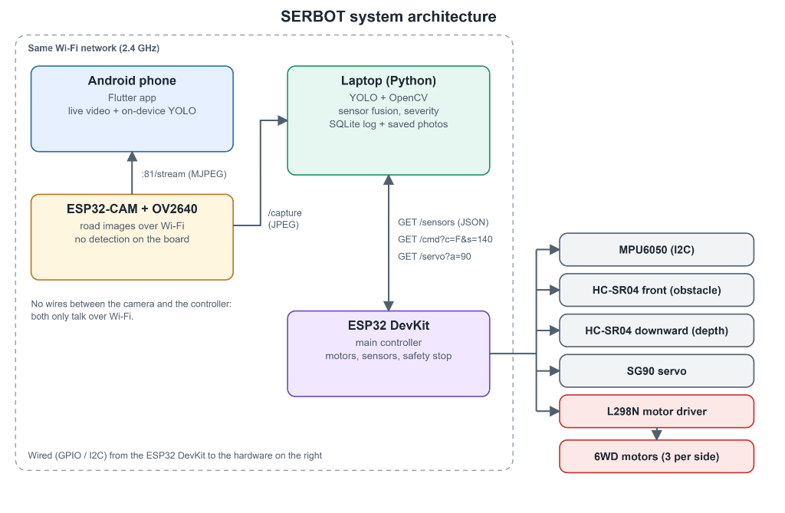
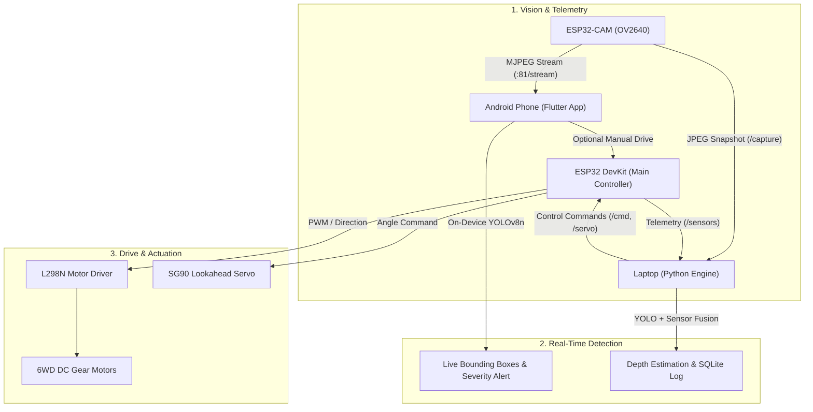
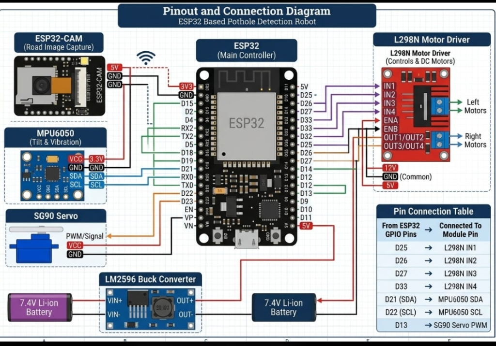
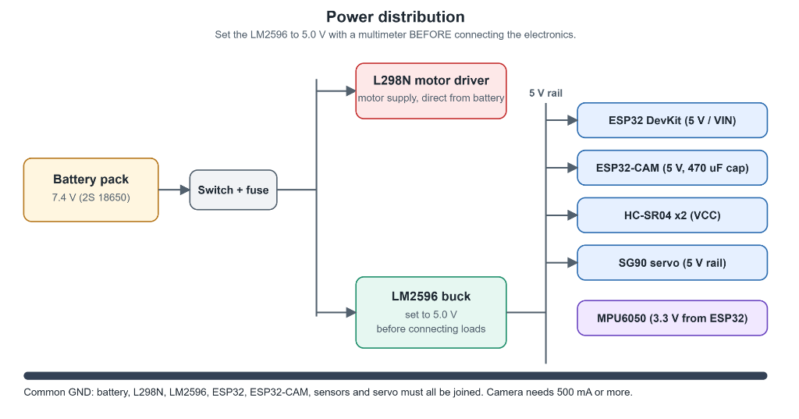
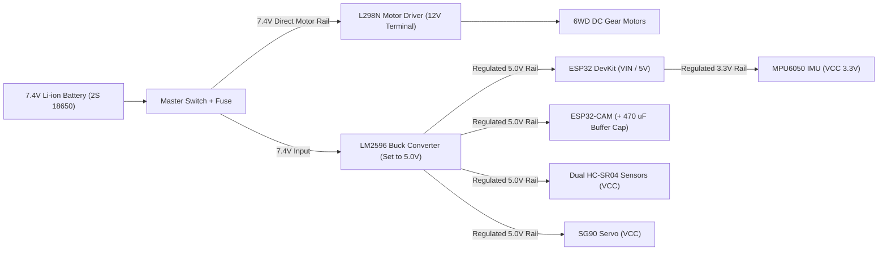

# PotFinder (SERBOT) - Edge-AI Autonomous Pothole Detection & Road Inspection Robot

[](https://flutter.dev)
[](https://www.tensorflow.org/lite)
[](https://www.espressif.com)
[](https://github.com/ultralytics/ultralytics)
[]()
[](https://creativecommons.org/licenses/by/4.0/)

An autonomous, edge-computing robotic platform designed for real-time pothole identification, multi-sensor road condition assessment, and automated road hazard severity scoring.

The system pairs an **ESP32-CAM** optical inspection unit with an **ESP32 DevKit** robotics chassis and an **on-device YOLOv8 Flutter application**, achieving zero-cloud, ultra-low-latency hazard detection over local 2.4 GHz Wi-Fi.

---

## Table of Contents
- [Key Features](#key-features)
- [System Architecture](#system-architecture)
- [Circuit Schematics & Hardware Wiring](#circuit-schematics--hardware-wiring)
- [Power Distribution Architecture](#power-distribution-architecture)
- [Computer Vision & Detection Pipeline](#computer-vision--detection-pipeline)
- [Severity Scoring Algorithm](#severity-scoring-algorithm)
- [Network & Communication Protocol](#network--communication-protocol)
- [Bill of Materials (BOM)](#bill-of-materials-bom)
- [Installation & Getting Started](#installation--getting-started)
- [Project Structure](#project-structure)
- [Attribution & Credits](#attribution--credits)

---

## Key Features

- **100% On-Device Edge AI**: High-speed neural inference on smartphone hardware via TensorFlow Lite (`pothole_model.tflite`). No internet connection, cloud API, or external GPU server needed.
- **Decoupled Dual-Microcontroller Architecture**: 
  - **ESP32-CAM**: Dedicated exclusively to high-throughput HTTP MJPEG video streaming (`:81/stream`) and snapshot capture (`/capture`).
  - **ESP32 DevKit**: Dedicated to motor actuation, ultrasonic collision avoidance, road depth measurement, and inertial telemetry.
- **6WD Robotic Drive Base**: Controlled through an L298N dual H-bridge motor driver for robust cross-terrain mobility over distressed asphalt.
- **Dual-Sensor Depth & Vibration Fusion**:
  - **HC-SR04 (Downward)**: Physical pothole depth profiling.
  - **HC-SR04 (Forward)**: Autonomous obstacle collision avoidance.
  - **MPU-6050 (6-DOF IMU)**: Road surface roughness, impact vibration, and chassis tilt.
- **Real-Time Hazard Severity Grading**: Dynamic 0-100 scoring based on hazard bounding box geometry, proximity to camera perspective horizon, and model prediction confidence.
- **Clean Modern Flutter Companion App**: Real-time visual bounding box rendering, live latency metrics (preprocess and inference time), visual telemetry, and historical defect logging with snapshot preservation.

---

## System Architecture

The robot separates high-bandwidth visual streaming from deterministic real-time hardware actuation. All high-level nodes interface over an ad-hoc or local 2.4 GHz Wi-Fi network.



### Architecture Workflow



---

## Circuit Schematics & Hardware Wiring

The central controller is a 30-pin **ESP32 DevKit V1**, communicating with motor drivers, sensors, and servos via designated GPIOs and the I2C bus.



### Pin Mapping Reference Table

| ESP32 Pin | Connected Hardware | Module Pin | Protocol / Signal Type | Description / Role |
|:---|:---|:---|:---|:---|
| **D25** | L298N Motor Driver | `IN1` | Digital Output (GPIO) | Left Motors Forward Direction |
| **D26** | L298N Motor Driver | `IN2` | Digital Output (GPIO) | Left Motors Reverse Direction |
| **D27** | L298N Motor Driver | `IN3` | Digital Output (GPIO) | Right Motors Forward Direction |
| **D33** | L298N Motor Driver | `IN4` | Digital Output (GPIO) | Right Motors Reverse Direction |
| **D21** | MPU-6050 IMU | `SDA` | I2C Data (Hardware I2C) | Gyroscope & Accelerometer Data |
| **D22** | MPU-6050 IMU | `SCL` | I2C Clock (Hardware I2C) | Gyroscope & Accelerometer Clock |
| **D13** | SG90 Micro Servo | `PWM` (Orange) | 50 Hz Hardware PWM | Camera Tilt / Elevation Adjustment |
| **3V3** | MPU-6050 IMU | `VCC` | 3.3V DC Power | Low-noise regulated 3.3V power |
| **5V / VIN** | LM2596 Buck Converter | `OUT+` (5.0V) | 5.0V DC Input | Primary logic supply rail |
| **GND** | Unified Common Bus | `GND` | Ground Reference | Common ground plane for all modules |

> [!NOTE]
> **No Physical Wires Between Camera and Controller:** The ESP32-CAM and ESP32 DevKit communicate strictly over Wi-Fi. This eliminates electrical noise injection from motor inductive spikes into sensitive camera CMOS lines.

---

## Power Distribution Architecture

Stable power delivery is critical to prevent ESP32 Wi-Fi brownouts (`Brownout detector was triggered`) caused by motor startup current transients.



### Power Distribution Scheme



### Critical Electrical Guidelines
1. **Buck Converter Calibration**: Adjust the LM2596 trimpot using a digital multimeter until the output reads **5.0V DC** *prior to connecting any microcontroller or camera module*.
2. **Brownout Suppression**: Solder an electrolytic capacitor (**470 uF to 1000 uF, 10V+**) across the `5V` and `GND` pins of the ESP32-CAM. Wi-Fi transmission bursts can draw instantaneous peaks exceeding 500 mA.
3. **Common Ground (`GND`)**: All ground lines (Battery negative, L298N GND, LM2596 OUT-, ESP32 GND, ESP32-CAM GND, and sensor grounds) **must be tied together** into a common ground plane.

---

## Computer Vision & Detection Pipeline

The vision pipeline processes live incoming frames from the HTTP stream using an edge-optimized custom YOLOv8 model packaged for mobile deployment.

```
Camera Frame (MJPEG) -> Stream Parser (FFD8...FFD9) -> Preprocessing (640x640 Letterbox)
                                                                 |
Severity Index Calculation <- Non-Maximum Suppression (IoU) <- TFLite Inference
```

### Model Specifications

| Parameter | Specification |
|:---|:---|
| **Base Architecture** | Ultralytics YOLOv8n (Nano) |
| **Target Runtime** | TensorFlow Lite (`tflite_flutter`) |
| **Model Artifact** | `assets/models/pothole_model.tflite` |
| **Input Shape** | `[1, 3, 640, 640]` float32 (Channels-First / NCHW) |
| **Input Normalization** | Pixel RGB values scaled to `[0.0, 1.0]`, Letterbox padded (`#727272` / 114) |
| **Output Shape** | `[1, 5, 8400]` - `[cx, cy, w, h]` (normalised 0-1 or absolute coords) + class confidence |
| **Flexibility** | Dynamic runtime tensor layout detection (automatically handles NCHW/NHWC and relative/pixel formats) |

---

## Severity Scoring Algorithm

Rather than reporting a plain bounding box, PotFinder computes a comprehensive **Severity Score (0 - 100)** for each detected road defect by analyzing geometric footprint, proximity to the vehicle, and detection certainty:

$$\text{Severity Score} = \text{clamp}\left(\Big(\frac{\text{Box Area}}{\text{Frame Area}} \times 600\Big)_{\le 70} + \Big(\frac{\text{Box Bottom}}{\text{Frame Height}} \times 20\Big) + (\text{Confidence} \times 10),\; 0,\; 100\right)$$

```dart
int severityScore(Det d, int fw, int fh) {
  final areaFrac = d.area / (fw * fh);
  var s = (areaFrac * 600).clamp(0, 70).toDouble();
  s += (d.b / fh).clamp(0, 1) * 20;     // Lower in the frame = closer to wheels
  s += d.conf * 10;                     // Model confidence weighting
  if (d.conf < 0.6 && s > 69) s = 69;   // Clamp low-confidence outliers
  return s.round().clamp(0, 100);
}
```

### Defect Classification Scale

| Score Range | Severity Grade | UI Indicator Color | Action Trigger |
|:---:|:---:|:---:|:---|
| **0 - 34** | **Minor** | `#42E0C0` (Teal) | Logged to database for routine road maintenance tracking. |
| **35 - 70** | **Moderate** | `#FFC629` (Amber) | Alert flagged; chassis speed lowered. |
| **71 - 100** | **Severe** | `#FF6A4D` (Coral Red) | Critical hazard; robot initiates emergency stop or evasive detour. |

---

## Network & Communication Protocol

The system operates across a unified local WLAN or through the ESP32-CAM's onboard SoftAP (`PotFinder-CAM` / `12345678`).

| Endpoint / Stream | Protocol | Port | Source | Target | Function |
|:---|:---:|:---:|:---|:---|:---|
| `http://<cam_ip>:81/stream` | HTTP MJPEG | `81` | ESP32-CAM | Flutter App | Live real-time video feed at 25-30 FPS |
| `http://<cam_ip>/capture` | HTTP GET | `80` | ESP32-CAM | Python Station | High-resolution single frame snapshot |
| `http://<dev_ip>/sensors` | HTTP JSON | `80` | ESP32 DevKit | Controller / App | Telemetry (depth, obstacle distance, roll/pitch) |
| `http://<dev_ip>/cmd?c=F&s=140` | HTTP GET | `80` | App / Station | ESP32 DevKit | Chassis motion command (`c`: direction, `s`: PWM speed) |
| `http://<dev_ip>/servo?a=90` | HTTP GET | `80` | App / Station | ESP32 DevKit | Camera lookahead tilt/pan servo position (`0° - 180°`) |

---

## Bill of Materials (BOM)

| Component | Quantity | Key Specifications / Notes |
|:---|:---:|:---|
| **ESP32 DevKit V1** | 1 | Dual-core Xtensa LX6, 2.4 GHz Wi-Fi + BLE, 30-pin board |
| **ESP32-CAM Board** | 1 | Includes OV2640 2MP Camera Module & MicroSD slot |
| **L298N Dual H-Bridge Driver** | 1 | Dual motor driver module with onboard 5V regulator jumper |
| **LM2596 DC-DC Step-Down Buck** | 1 | High-efficiency buck converter (set to precisely 5.00 V) |
| **MPU-6050 Sensor Module** | 1 | 3-axis accelerometer + 3-axis gyroscope with integrated DMP |
| **HC-SR04 Ultrasonic Sensors** | 2 | 1x forward (obstacle detection), 1x downward (pothole depth) |
| **SG90 Micro Servo Motor** | 1 | 9g servo for camera tilt elevation |
| **6WD Robot Chassis & Motors** | 1 | 6x TT DC Gear Motors with all-terrain wheels |
| **Li-ion Battery Pack** | 1 | 7.4V (2S 18650 configuration, >= 2500 mAh) with safety BMS |
| **Electrolytic Capacitor** | 1 | 470 uF / 16V (placed across ESP32-CAM 5V-GND) |
| **Rocker Switch & Fuse Holder** | 1 | In-line SPST master power switch + 3A fast-blow fuse |

---

## Installation & Getting Started

### 1. Prerequisites
- [Flutter SDK](https://docs.flutter.dev/get-started/install) (`>= 3.3.0`)
- Android Studio with Android SDK API Level 26+ (`minSdk = 26`)
- Physical Android phone with **USB Debugging** enabled

### 2. Android Manifest Configuration
To permit streaming over plain local HTTP connections, ensure these permissions exist in `android/app/src/main/AndroidManifest.xml`:

```xml
<manifest xmlns:android="http://schemas.android.com/apk/res/android">
    <uses-permission android:name="android.permission.INTERNET"/>
    
    <application
        android:usesCleartextTraffic="true"
        android:label="PotFinder"
        android:icon="@mipmap/ic_launcher">
        <!-- ... existing application elements ... -->
    </application>
</manifest>
```

### 3. Deploy Mobile Application
```bash
# Clone the repository
git clone https://github.com/drax-glitch/pothole-finder.git
cd pothole-finder

# Install Dart & Flutter dependencies
flutter pub get

# Verify device connectivity
flutter doctor
flutter devices

# Launch on connected Android device
flutter run --release
```

### 4. Operational Checklist
1. **Power Sequence**: Turn on the battery master switch. Verify the LM2596 output LED lights up.
2. **Wi-Fi Connection**:
   - Connect the Android phone to the ESP32 Wi-Fi network (or router sharing the same 2.4 GHz SSID).
   - **Important**: Disable *"Switch to mobile data automatically"* in your phone's Wi-Fi advanced settings.
3. **Configure Feed**:
   - Open the **PotFinder** application.
   - Navigate to the **Setup** tab.
   - Input your camera's stream URI: `http://192.168.4.1:81/stream` (or local station IP `http://<ip>:81/stream`).
   - Tap **Save & Connect**.
4. **Initiate Detection**:
   - Switch to the **Live** tab to confirm video streaming.
   - Tap **START DETECTING**. The app will letterbox each frame to 640x640, execute inference, and display bounding boxes with real-time severity ratings and inference latency.

---

## Project Structure

```
pothole-finder/
├── assets/
│   └── models/
│       └── pothole_model.tflite     # Edge-quantized YOLOv8n TFLite model
├── docs/
│   └── images/
│       ├── circuit_pinout.jpg       # Pinout and electrical connection schematic
│       ├── power_distribution.png   # Dual-rail battery power tree
│       ├── system_architecture.png  # Distributed multi-node SERBOT architecture
│       └── serbot_system_demo.mp4   # System demonstration video
├── lib/
│   ├── main.dart                    # Application entry point & theme configuration
│   ├── detector.dart                # TFLite YOLOv8 inference engine & bounding box decoder
│   ├── mjpeg.dart                   # High-performance HTTP MJPEG binary stream reader
│   ├── overlay.dart                 # Real-time bounding box & HUD painter
│   ├── state.dart                   # Application state & stream lifecycle manager
│   ├── theme.dart                   # Dark asphalt UI theme & color tokens
│   ├── vision_math.dart             # Box geometry, NMS, & severity calculations
│   └── screens/
│       ├── connect.dart             # Stream connection & IP setup screen
│       ├── history.dart             # Local defect log with saved snapshots
│       ├── live.dart                # Live detection canvas
│       ├── photo_test.dart          # Static image inference testing tool
│       └── settings.dart            # Inference thresholds & model diagnostics
├── pubspec.yaml                     # Dependencies (tflite_flutter, image, etc.)
└── README.md                        # Documentation
```

---

## Attribution & Credits

- **Detection Model Dataset**: Based on the *"pothole"* dataset by [Yeeun Kim](https://universe.roboflow.com/yeeun-kim/pothole) hosted on [Roboflow Universe](https://universe.roboflow.com), licensed under [CC BY 4.0](https://creativecommons.org/licenses/by/4.0/).
- **Model Framework**: [Ultralytics YOLOv8](https://github.com/ultralytics/ultralytics) exported to TensorFlow Lite.
- **Embedded Vision**: [Espressif ESP32-CAM](https://github.com/espressif/esp32-camera) and FreeRTOS.
